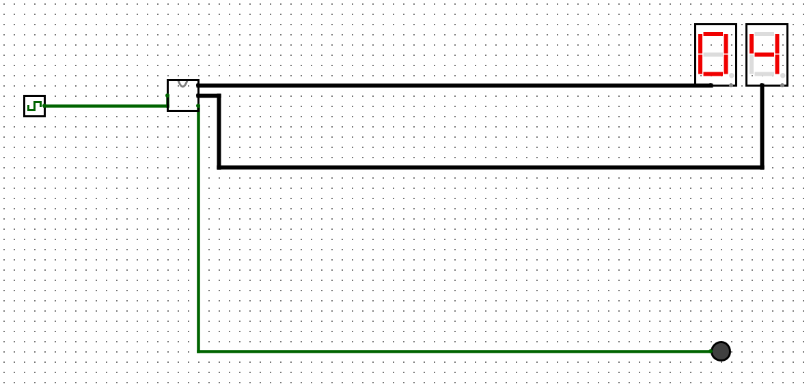
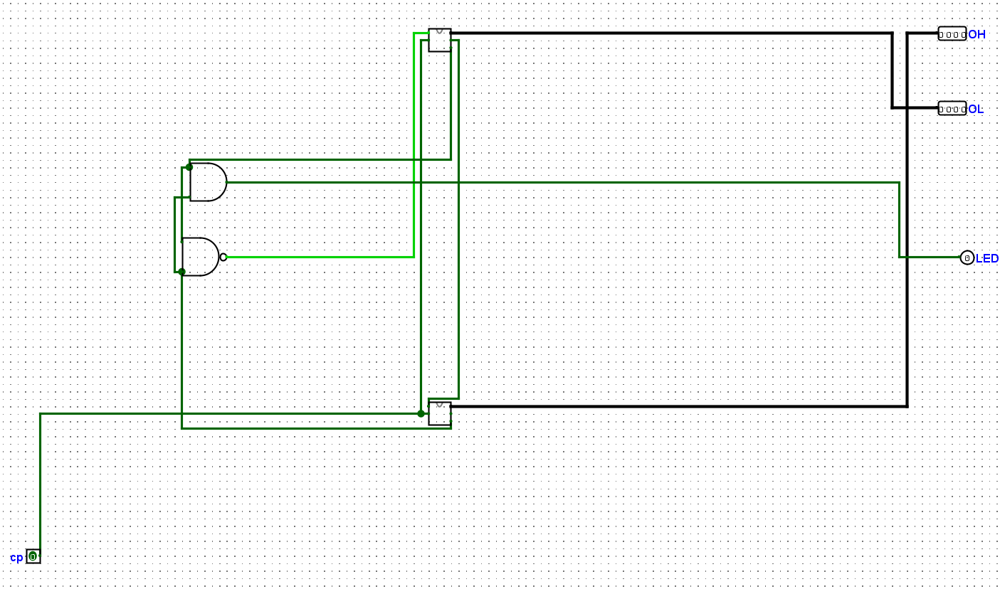
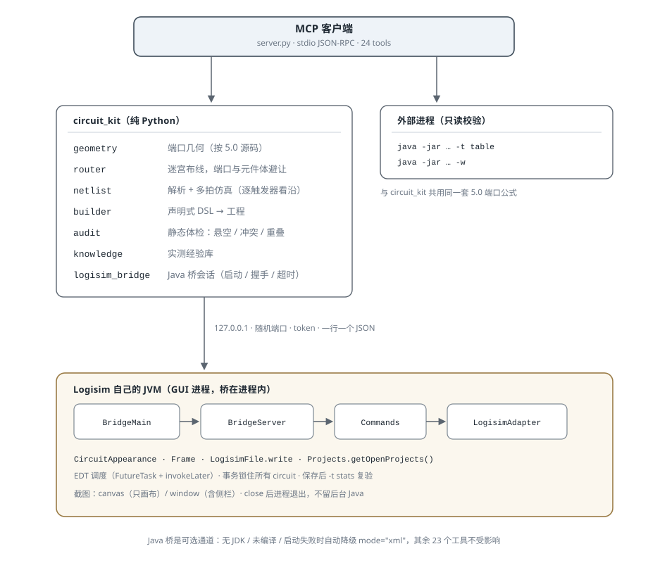

# logisim-mcp

> 把 Logisim-evolution 接进 AI 工作流的 MCP 插件：查几何 → 声明式生成 → 静态体检 → 网表仿真 → Logisim 真值表复核 → GUI 内编辑外观，全链路可验证，不用手算一个坐标。
>
> 其中「编辑外观」这一步由内置的 Java 桥完成：它把一条本地控制通道注入 Logisim 自己的 JVM，
> 直接调用 `CircuitAppearance` 等内部 API，界面实时刷新，不靠模拟鼠标、不改 XML 再重开。

[](https://github.com/CosmoXing/logisim-mcp/actions/workflows/ci.yml)
[](LICENSE)
[](https://www.python.org/)
[](https://github.com/logisim-evolution/logisim-evolution)

---

## 长什么样

顶层 `main`：时钟进 `CounterDue`，右侧两位十六进制数码管 + 溢出 LED（时钟开着，正在走字）：



中间层 `CounterDue`：`cp` 同时打到两个 `Counter13`，左边的 `AND` / `NAND` 负责「到 `CC` 就停住、点亮 LED」，
右侧 `OH` / `OL` 是两位输出。



门级 `Counter13`（一位的内部）：4 个 D 触发器、每位一组异或/与门算次态、右上角分线器把 4 位
并成总线，没有用到任何现成计数器件：


整个工程三层（`main` → `CounterDue` → `Counter13`），26 个门与触发器全部由一份网表生成，没有一根隧道。

下面的数字不是手写的，是 `circ_sim` 一拍一拍推出来的原文：

```text
t      OH     OL    LED
0    0000   0000      0      上电
1    0000   0001      0
12   0000   1100      0      低位到 C
13   0001   0000      0      进位，低位归零
…    …      …         …
167  1100   1011      0
168  1100   1100      1      两位都到 C：停住，LED 亮
172  1100   1100      1      再打 4 拍也不动
```

> 为什么不用 Logisim 自带的测试向量验：`-w` 每行都从初始状态重新求值，触发器状态不会在行之间保持，
> 时序电路只能靠 `circ_sim` 逐拍推——上面这张表就是这么来的。

## 它解决什么问题

Logisim-evolution 是纯 Java Swing 桌面程序，没有任何脚本或网络接口。想用代码生成电路，只有两条老路，都不好用：

- 手写 `.circ` 的 XML：坐标是按元件几何算出来的。门输入口在 5.0 是 `loc.x-50`，3.9 是 `-20`；触发器 `Q(0,0)` 与 `~Q(0,20)` 只隔 20px；子电路端口按 facing 分边而不是等距排。错一个就进入"每修好一处、另一处又坏"的循环。
- 只用 `-t table` 验：它只告诉你结果是 `E`，不告诉你哪根线断了。而 `-w` 测试向量每一行都从初始状态重新求值，根本验不了时序电路。

这个插件补的是中间那一层：一份可信的几何数据源、一个会避让端口的迷宫布线器、一个能跑多拍的网表仿真器，以及一份会成长的踩坑库。

## 特性

| 能力 | 说明 |
|---|---|
| 声明式生成 | 写网表（`pins` / `components` / `nets`），自动布局 + A* 布线；不使用隧道，符合多数课程作业限制 |
| 静态体检 | 落盘后重建网表，报悬空 / 多驱动冲突 / 孤立端口 / 位宽冲突 / 断头线 / 元件体重叠，定位到网络名与坐标 |
| 多拍仿真 | 逐拍推进，逐触发器/寄存器检测各自的时钟沿——同步与行波级联都算得对 |
| 几何与交叉复核 | 生成/布线/解析统一按 5.0 源码公式；`selftest` 再用 Logisim 真值表做外部复核 |
| 失败显性 | 寄存器 / 多路选择器 / 译码器 / 比较器已纳入网表；仍不认识的元件由 `circ_audit` 标 `partial` 并列出名字与位置，不再当作成功 |
| 经验库 | 随包 83 条实测坑（`circ_kb` 可增补；技能里另有 A~K 组坑表，含 2.7.1 / 2.15）；含 3.2 存储器实战：RAM/ROM 几何、低位交叉、字节使能、connect 连通性盲区 |
| Java 桥 | 把 `CircuitAppearance` 等进程内 API 暴露成回环 NDJSON 命令，GUI 内实时改外观、截图、保存 |
| 零依赖 | 纯 Python 标准库；Java 只在跑 Logisim 原生能力与外观编辑时需要 |

## 安装

### 方式一：作为插件安装（推荐）

插件按 WorkBuddy / CodeBuddy 的插件规范打包（`.codebuddy-plugin/plugin.json` + `.mcp.json` + `skills/`）。

```bash
git clone https://github.com/CosmoXing/logisim-mcp.git
cd logisim-mcp
python tools/install.py            # 注册本地市场 logisim-local
```

然后在插件管理页安装 `logisim-mcp`，并到「自定义连接器」里对 `logisim` 点一次 信任（Trust）。

不想注册市场，也可以只写 MCP 配置：

```bash
python tools/install.py --mcp-only       # 直接并入 ~/.workbuddy/mcp.json
python tools/install.py --uninstall      # 撤销
```

### 方式二：手动接任意 MCP 客户端

在客户端的 MCP 配置里加：

```json
{
  "mcpServers": {
    "logisim": {
      "type": "stdio",
      "command": "python",
      "args": ["<插件绝对路径>/server/server.py"],
      "cwd": "<插件绝对路径>",
      "env": { "PYTHONUTF8": "1", "PYTHONIOENCODING": "utf-8" }
    }
  }
}
```

> Windows 上如果 `python` 不在 PATH，把 `command` 换成解释器绝对路径，或用 `bin/run-mcp.cmd`。

### 方式三：完全不用 MCP

`skills/logisim-circuit-design/scripts/` 里的脚本可以独立运行：

```bash
python skills/logisim-circuit-design/scripts/verify.py table skills/logisim-circuit-design/assets/full-adder.circ
python skills/logisim-circuit-design/scripts/verify.py stats demo.circ
python skills/logisim-circuit-design/scripts/verify.py vector main case.vec demo_test.circ
python skills/logisim-circuit-design/scripts/mem_gen.py demo_mem.circ   # 64KB ROM + 64KB RAM
```

## 依赖与环境

| 依赖 | 必需 | 说明 |
|---|---|---|
| Python 3.8+ | 是 | 只用标准库，无需 `pip install` |
| Java | 否 | 只有真值表 / 统计 / `-w` / GUI / 外观编辑需要 |
| JDK 21+ | 否 | 仅编译 Java 桥时用；只运行用 JRE 即可 |
| `logisim-evolution-*-all.jar` | 否 | 同上。生成、体检、网表仿真是纯 Python |

jar 的查找顺序：

```
LOGISIM_JAR 环境变量
  → <插件>/logisim.local.json 的 "jar"
  → <插件>/runtime/*.jar
  → ${CODEBUDDY_PLUGIN_DATA}/runtime/
  → Program Files / Program Files (x86) / LOCALAPPDATA 下的 logisim-evolution/app
  → ~/.logisim、~/logisim
  → 当前目录
```

想随插件分发内核，把 jar 放进 `runtime/`；只想本机用，就复制 `logisim.local.example.json` 为 `logisim.local.json` 填路径（已被 gitignore）。

## 自检

```bash
python server/server.py --doctor     # 环境体检：python / java / jar / 知识库 / 清单
python tools/selftest.py             # 29 项端到端回归（含失败路径与 Logisim 交叉复核）
python tools/check_release.py        # 开源发布检查：版本一致 / 无本机痕迹 / 打包内容
```

`--doctor` 输出示例：

```
插件根目录 : .../logisim-mcp
服务端版本 : logisim 1.1.0
Python     : 3.12.4 (/usr/bin/python3)
Java       : /usr/bin/java
内核 jar   : ~/.logisim/logisim-evolution-5.0.0-all.jar
经验库     : .../knowledge.json
  条目数   : 19
  可写     : 是
插件清单   : logisim-mcp 1.1.0（skills=1）
生成/体检  : ok（悬空 0，冲突 0）
网表仿真   : a=1,b=1 → y=1（应为 1）
```

## 工具一览（18 个）

工具按 **Logisim 版本**分三组，**不要跨版本混用**（几何互不兼容）：

| 前缀 | 版本 | 数量 | 说明 |
|---|---|---|---|
| `logisim_info` | 通用 | 1 | 探测 jar / Java / 无头能力 |
| `circuit_*` / `circ_*` | **5.0（evolution）** | 14 | 真值表、向量、几何、体检、仿真、生成、外观、经验库 |
| `circ271_*` | **2.7.1 / 2.16（Logisim-ITA）** | 3 | 独立的 2.7.1 语义层：端口 / 体检 / 仿真 |

版本判定看 `.circ` 头部的 `source=`。完整对照（含 3.9、几何差异、skill 脚本归属）见
**[docs/VERSIONS.md](docs/VERSIONS.md)**。

| 工具 | 作用 |
|---|---|
| `logisim_info` | 探测 jar / Java / 无头能力 |
| `circuit_summary` | 解析 `.circ`，列出电路、引脚（名/向/位宽）、元件数 |
| `circuit_truth_table` | Logisim 真值表。`U` 未知、`E` 冲突；输入 >16 拒绝，默认截断 4096 行 |
| `circuit_verify` | 真值表与期望向量逐条比对 |
| `circuit_test_vector` | `-w` 向量引擎。只能验组合逻辑 |
| `circuit_stats` | 元件统计 |
| `circuit_build` | 旧版生成器（通道布线 + 隧道），保留兼容 |
| `circuit_open_gui` | 打开 GUI |
| `circ_geometry` | 查元件真实端口偏移 / 包围盒（5.0 源码 + 实测；支持 register / mux / decoder / comparator 等） |
| `circ_probe` | 用 Java 桥让 Logisim 自己报任意元件的包围盒、端口坐标与位宽 |
| `circ_audit` | 静态体检：悬空 / 多驱动 / 孤立 / 位宽冲突 / 断头线 / 重叠 |
| `circ_sim` | 网表级多拍仿真，逐触发器/寄存器检测时钟沿 |
| `circ_build` | 声明式多电路生成，迷宫布线，不使用隧道 |
| `circ_kb` | 经验库：list / search / add |
| `circ_appearance` | 在运行中的 Logisim JVM 里编辑子电路外观：get / auto / apply / preview / save / reset / close |
| `circ271_check` | **2.7.1 / ITA 2.15·2.16** 静态体检：按 2.7.1 实测几何/语义重建网表，查位宽、驱动、穿体、sel/en 接入方向 |
| `circ271_sim` | **2.7.1 / ITA 2.15·2.16** 网表仿真：驱动输入 Pin → 打时钟 N 拍 → 读引脚 / Tunnel（DM、GRF 等原始元件电路） |
| `circ271_ports` | **2.7.1 / ITA 2.15·2.16** 端口几何：Splitter 分支、门、RAM 五控制脚、Decoder/Mux 的实测坐标 |

## 版本支持：5.0 / 2.7.1 / 2.16 / 2.15

三套几何互不兼容，**混用会出现「修好一处、另一处又坏」**。
判定依据是 `.circ` 头部的 `source=`，不是你装的 Logisim 版本：

| `source=` | 用哪套 | 代码入口 |
|---|---|---|
| `5.0` | 5.0 几何 | `circuit_kit/geometry.py`，工具 `circ_*` / `circuit_*` |
| `2.16` / `2.7` | 2.7.1 几何 | `circuit_kit/circ271.py`，工具 `circ271_*` |
| `2.15` | ITA 几何：AND/OR 输入 `x-30`、XOR `x-40`、**NOT `x-20`**、偶数输入中间 20px 空档；MUX 需 `enable=false`，Comparator/BitExtender/Shifter/南向 Splitter 见技能 `references/geometry.md` 第 11 节 | 静态检查用 `circ271_*`；功能验证用 `scripts/v271/ita_probe.py`，构建用 `scripts/v215/board215.py`，ALU 用 `gen_alu_lab3.py` + `verify_alu_lab3.py` |
| `3.9` | 3.9 几何 | 未落地为代码，差异表见 [docs/VERSIONS.md](docs/VERSIONS.md) |

> 2.15 说明：`circ271_check` 的门体模型按原始 2.7.1（输入 x-50）建模，对 2.15/2.16 会把
> 20px 输入短线误判为“导线穿元件体”，属已知误报；以 Logisim 自身 `ERRCOUNT` 与
> `ita_probe` 向量为准。`circ271_check` 检测到 `source="2.15/2.16"` 时会在首行给出提示。

> 2.16 说明（IO/数码管类电路）：`7-Segment Display` 的 8 个输入脚是
> `a=(+20,0) b=(+30,0) c=(+20,+60) d=(+10,+60) e=(0,+60) f=(+10,0) g=(0,0) dp=(+30,+60)`；
> `active` 是**布尔属性**，只能写 `true/false`（写 `high` 会被当成 `false` → 整块反相，且不报错）；
> 导线必须横平竖直且长度为 10 的倍数，否则 `WireRepair` 死循环、加载直接 `OutOfMemoryError`。
> 自检：`scripts/v271/sevenseg.py check|table|demo`、`netmap.py --overlap|--grid`。

程序里可直接路由：

```python
from circuit_kit.versions import get, detect
geo = get("2.16")          # -> circuit_kit.circ271
ver = detect("xxx.circ")   # -> '2.16'
```

2.7.1 / 2.16 与 5.0 在库索引、端口几何、元件语义上都不同，不能共用
`circ_audit` / `circ_sim`。本仓库为此提供独立的语义层 `server/circuit_kit/circ271.py`，
对应 3 个工具：

```
circ271_check  {"file":"D:/CPU.circ","circuit":"DM"}          # → errors=0 warnings=0
circ271_sim    {"file":"D:/CPU.circ","circuit":"DM",
                "inputs":{"MemWrite":1,"ALU result":"0x4","RD2":"0xdeadbeef"},
                "cycles":1,"watch":["ReadData","bank","wr"]}   # → ReadData=0xdeadbeef
circ271_ports  {"file":"D:/CPU.circ","circuit":"DM","component":"RAM"}
```

### 2.7.1 与 5.0 的关键差异（已固化进工具）

| 项 | 2.7.1 实测语义 |
|---|---|
| Splitter 分支 | east：`y - 10*fanout + 10*i`；west：`y + 10*(i+1)` |
| 门电路 | `inputs` 默认 5；输入在 `x-50`，纵向 40px 内均布（2 输入为 `y±20`） |
| Decoder 禁用输出 | 默认悬空(Z)；`disabled=0` 才输出 0。RAM 的 WE 是「≠0 即写」，悬空会每拍误写 |
| MUX / Decoder 的 sel/en | 必须从符号下方接入，横穿会悬空/报错 |
| RAM 底部五脚 | `str(-110) / cs(-90) / clk(-70) / oe(-50) / clr(-30)`；CS/OE 悬空按使能处理 |
| Register 的 en | 只有 `en == FALSE` 才禁止加载，悬空等价使能 |
| Pin 语义 | `output=true` 是电路输出（负载）；输入 Pin 才是驱动源 |
| 保存省略默认值 | 会丢掉 `fanout`、`enable` 等等于默认值的属性，工具需按推导值处理 |

### 限制

- `circ271_sim` 只覆盖原始元件（Pin/Tunnel/Splitter/Constant/门/Comparator/Decoder/Mux/RAM/ROM/Register）；
  子电路、Adder/Shifter 等会列入 `unknown_components`。
- 整机 CPU（含 IFU/GRF/ALU 子电路）请用 Logisim 2.7.1 引擎的 Java 侧仿真（见
  `skills/.../references/cpu271-casebook.md`），或把子电路展平后再跑 `circ271_sim`。
- 2.7.1 的 `-w` / `-t table` 无头能力有限（无原生测试向量），验证以网表仿真 + 引擎仿真为主。

## 60 秒例子

```
circ_build  {"file":"/tmp/demo.circ","circuits":[{"name":"main",
  "pins":[{"label":"a","dir":"in"},{"label":"b","dir":"in"},{"label":"y","dir":"out"}],
  "components":[{"id":"g1","type":"AND"}],
  "nets":[{"name":"a","connect":["pin:a","g1.a"]},
          {"name":"b","connect":["pin:b","g1.b"]},
          {"name":"y","connect":["g1.out","pin:y"]}]}]}

circ_audit  {"file":"/tmp/demo.circ"}                         # → 体检结论: ok
circ_sim    {"file":"/tmp/demo.circ","inputs":{"a":1,"b":1}}  # → y=1
```

生成的文件可以直接用 Logisim 打开、仿真、截图。

## 子电路外观编辑与 Java 桥

### 为什么需要 Java 桥

Logisim-evolution 是纯 Java Swing 桌面程序，没有脚本接口；`CircuitAppearance`、`AppearancePort`、
`Projects.getOpenProjects()` 这些都是进程内 Java API，外部无法直接调用。改 `.circ` 的 `<appear>`
再重开文件虽然可行，但看不到实时效果、也拿不到 Logisim 自己的渲染结果（类型校验、端口对位、保存规范化）。

Java 桥的做法是：不改造 Logisim，也不远程操控界面，而是用它自己的 `Main.main` 启动 GUI，
在同一个 JVM 里挂一个只监听 `127.0.0.1` 的 NDJSON 控制服务。Python 侧发命令，Java 侧在事件线程里
调用 Logisim API，效果等同于人在界面上操作。

### 组成

| 文件 | 职责 |
|---|---|
| [`server/java/src/logisim/bridge/BridgeMain.java`](server/java/src/logisim/bridge/BridgeMain.java) | 启动器：解析 `--portfile` / `--log`，先起控制服务，再调用 `Main.main(args)` 打开 GUI |
| [`BridgeServer.java`](server/java/src/logisim/bridge/BridgeServer.java) | 回环地址 + 随机端口 + 32 字节随机 token；一行一个 JSON，命令串行；`close` 回包后退出进程 |
| [`Commands.java`](server/java/src/logisim/bridge/Commands.java) | 命令分派（11 条），只做参数提取 |
| [`LogisimAdapter.java`](server/java/src/logisim/bridge/LogisimAdapter.java) | 真正干活的层：定位 Project/Frame/Circuit、读写外观、截图、保存、回滚 |
| [`Edt.java`](server/java/src/logisim/bridge/Edt.java) | 把任务丢到 Swing 事件线程并带超时等结果（`FutureTask` + `invokeLater`） |
| [`Json.java`](server/java/src/logisim/bridge/Json.java) / `BridgeException.java` | 极简 JSON 编解码（不引入第三方库）/ 带 code、hint、detail 的异常 |
| [`server/circuit_kit/logisim_bridge.py`](server/circuit_kit/logisim_bridge.py) | Python 会话：编译检查、启动/复用、握手、请求超时、日志与错误码 |

### 编译与启动

```bash
python tools/build_bridge.py          # 需要 JDK 21+，产出 runtime/bridge/logisim-bridge.jar
```

Python 侧实际拉起的进程是：

```bash
java -Dfile.encoding=UTF-8 \
     -cp "runtime/bridge/logisim-bridge.jar:<logisim-evolution-5.0.0-all.jar>" \
     logisim.bridge.BridgeMain --portfile=<run>/bridge.json --log=<run>/agent.log <file.circ>
```

- jar 顺序不能反：桥的类在前、Logisim 内核在后，否则 `BridgeMain` 找不到。
- `-Dstdout.encoding` 等一并设为 UTF-8，避免 Windows 控制台编码把中文日志写坏。
- 子进程的 `stdin` 置为 `DEVNULL`。Logisim 启动时会读标准输入，继承父进程的管道会导致 GUI 卡死。
- 会话目录优先级：`%LOCALAPPDATA%\logisim-mcp\run\<hash>` → 系统临时目录 → `runtime/bridge`，
  前两级不可写时自动降级。

### 握手与状态

启动后桥会写 `bridge.json`（原子替换）：

```json
{"protocol":1,"state":"starting|ready","port":51234,"token":"…","pid":1234,"started":"…"}
```

`state` 只有在 Logisim 真的打开了工程（`Projects.getOpenProjects()` 非空，最多等 90s）后才变成
`ready`。Python 侧只有在 `ready` + `ping` 成功时才复用已有会话，否则重新拉起；进程已死的残留状态文件会被忽略。

### 协议

请求一行、响应一行，UTF-8 JSON：

```json
{"v":1,"id":7,"token":"…","cmd":"appearance_apply","params":{"spec":{…}}}
{"v":1,"id":7,"ok":true,"result":{…},"elapsed_ms":12}
```

失败时返回 `ok:false` 与 `{"code","message","hint","detail"}`。命令包括：

| 命令 | 作用 |
|---|---|
| `ping` / `status` | 探活 / 报告打开的文件、工程、当前电路 |
| `list_circuits` / `select_circuit` | 列电路 / 切换当前电路 |
| `show_view` | 在 `layout` 与 `appearance` 视图间切换 |
| `appearance_get` / `appearance_apply` / `appearance_reset` | 读 / 写 / 还原外观 |
| `screenshot` | 截图，`kind=canvas` 只截画布、`kind=window` 连侧栏一起 |
| `save` / `close` | 写回 `.circ` / 回包后退出进程 |

### 三个必须这么写的实现细节

1. EDT 调度用 `FutureTask` + `invokeLater`：Java Swing 的 API 必须在事件分发线程上调用，
   但桥线程不能 `invokeAndWait`（容易和模态框互等死锁），因此提交任务后带超时等结果，
   超时返回 `E_EDT_TIMEOUT` 而不是把整个会话挂住。
2. 事务要锁住文件里所有电路：改外观会移动端口，进而改变父电路的 `ends`。只锁子电路会抛
   `CircuitLocker$LockException: ends changed outside transaction`；`withTransaction` 因此把所有
   `Circuit` 都放进 `READ_WRITE`。
3. 保存交给 Logisim 自己：通过 `LogisimFile.write` 落盘（先备份 `.bak-时间戳`），再由
   `java -jar … -t stats` 重新加载校验，确认写出来的文件 Logisim 自己能打开。

### MCP 用法

```json
{"action":"auto",   "file":"D:/work/2.3.circ", "circuit":"mul"}
{"action":"preview","file":"D:/work/2.3.circ", "circuit":"mul", "out":"D:/work/mul.png"}
{"action":"save",   "file":"D:/work/2.3.circ", "circuit":"mul"}
```

默认保留现有端口坐标（避免父电路导线脱开），只重画框体/名称牌/标签；要均匀重排端口，传
`"layout":{"preserve_port_positions":false}`，返回的 `impact` 会给出受影响的父电路导线数。
没有 JDK / 桥编译失败时，`mode="xml"` 会退化为直接改 `<appear>`（无实时预览）。

### 错误码

| 错误码 | 含义 | 处理 |
|---|---|---|
| `E_BRIDGE_NOT_BUILT` | 没有 `runtime/bridge/logisim-bridge.jar` | 跑 `tools/build_bridge.py` |
| `E_NO_JAR` | 找不到 Logisim 内核 jar | `--doctor` 看查找顺序，或配 `logisim.local.json` |
| `E_BRIDGE_TIMEOUT` | 60s 内没进 `ready` | 看会话目录里的 `agent.log`（多为启动参数/显示环境问题） |
| `E_BRIDGE_EXIT` | 桥进程启动后退出 | `agent.log` 里通常有 Java 异常原文 |
| `E_BRIDGE_DOWN` | 连接中断 | 会话会自动重启；频繁出现多半是 Logisim 崩溃 |
| `E_AUTH` | token 不匹配 | 复用到了别的会话的 `bridge.json`，删掉会话目录重来 |
| `E_EDT_TIMEOUT` | 界面被模态框挡住或卡住 | 关掉 Logisim 的弹窗后重试 |

安全边界：只绑定回环地址、端口随机、token 每次启动重新生成、不写入任何系统位置；
`close` 会让进程退出，不会留下后台 Java 进程。

详见 [`docs/APPEARANCE.md`](docs/APPEARANCE.md)。

## 架构



关键设计：`geometry.py`（生成侧）、`router.py`（布线）与 `netlist.py`（解析侧）都按 5.0 源码实现端口公式。
三处目前是同源拷贝，改几何常量必须同步；只改一处会让生成、体检、仿真对不上。

Java 桥是可选通道：没有 JDK、没有编译产物或启动失败时，`circ_appearance` 会报明确错误码或
降级到 `mode="xml"`，其余 13 个工具完全不受影响。

## 兼容性

| 项 | 支持 |
|---|---|
| Logisim-evolution | 5.0（默认，几何按 5.0 源码）／ 3.9（读写兼容，但端口坐标不同，见技能里的对照表） |
| Logisim 2.7.1 | 独立语义层 `circ271_check / circ271_sim / circ271_ports`（几何与语义按 2.7.1 实测） |
| Python | 3.8+（CI 覆盖 3.9 与 3.12） |
| 操作系统 | Windows / macOS / Linux（`.cmd` 与 `.sh` 启动器） |
| MCP 协议 | `2024-11-05`（stdio） |

## 已知限制

- `-w` 不能验时序：Logisim 每行都重置状态。时序请用 `circ_sim`，或把触发器换成引脚做组合镜像。
- stdio 单线程：一次长真值表会挡住后续调用。这是 stdio 的常态，未引入线程池（会带来子进程回收问题）。
- GUI 自动化只覆盖外观编辑：Java 桥能切电路、切视图、改外观、截图与保存；画布上的鼠标拖拽、
  连线仍只能人工。`circuit_open_gui` 只负责把文件打开。
- Java 桥需要图形环境：Logisim 的 `Main.main` 会创建 Swing 窗口，纯无头服务器上无法启动，
  这类环境请用 `mode="xml"`。
- 只覆盖数字电路：模拟电路、Verilog/VHDL 综合不在范围内。
- 2.7.1 工具只覆盖原始元件电路；子电路、算术库元件（Adder/Shifter/BitAdder）未建模，
  整机级验证请用 2.7.1 引擎的 Java 侧仿真或先展平子电路。

## 目录结构

```
.
├── .codebuddy-plugin/plugin.json   插件清单（名称/版本/随包技能）
├── .mcp.json                       MCP 服务声明（stdio）
├── bin/                            启动器（自动定位 python）
├── server/
│   ├── server.py                   18 个工具 + --doctor
│   ├── java/src/logisim/bridge/     Java 桥：BridgeMain / BridgeServer / Commands / LogisimAdapter / Edt / Json
│   └── circuit_kit/                geometry / router / netlist / builder / audit / knowledge / appearance / logisim_bridge / circ271
├── runtime/bridge/                 编译产物 logisim-bridge.jar（gitignore）；会话状态与日志的兜底目录
├── skills/logisim-circuit-design/  随包技能：SKILL.md + 14 份参考 + 30 个脚本 + 示例电路
├── tools/                          selftest / build_bridge / build_zip / install / sync_skill / check_release
├── docs/                           架构说明、插件规范、截图
└── examples/                       可直接打开的示例电路（含两位 13 进制计数器）
```

## 文档

| 文档 | 内容 |
|---|---|
| [`docs/ARCHITECTURE.md`](docs/ARCHITECTURE.md) | 模块职责、数据流、为什么两套几何 |
| [`docs/APPEARANCE.md`](docs/APPEARANCE.md) | Java 桥与外观编辑：spec 字段、父电路回归、错误码 |
| [`docs/PLUGIN-SPEC.md`](docs/PLUGIN-SPEC.md) | 插件目录规范、`plugin.json` / `.mcp.json` 字段、占位符 |
| [`docs/DESIGN-NOTES.md`](docs/DESIGN-NOTES.md) | 从 0 到 1 的取舍：为什么不用隧道、为什么失败要显性 |
| `skills/.../references/counter13-casebook.md` | 十三进制计数器复盘：13 个坑 + 排查决策树 |
| `skills/.../references/memory-casebook.md` | 64KB ROM/RAM 低位交叉：结构、RAM/ROM 端口、生成器、37/37 验证、12 坑 |
| `skills/.../references/pitfalls.md` | 实测坑表（A-L 组；J 组为 Logisim 2.7.1，K 组为 ITA 2.15，L 组为 ITA 2.16 的数码管/文本/GUI 键盘） |
| `skills/.../references/cpu271-casebook.md` | 2.7.1 32 位 CPU 纠错复盘：DM 三错、ROM、验证链与 10 条语义坑 |
| `skills/.../references/alu215-casebook.md` | 2.15 8 位 ALU（带比较器）复盘：结构、标志语义、16604 行验证、K12~K19 与布局压缩 |

## 开发

```bash
python tools/selftest.py                # 全量回归
python tools/selftest.py --quick        # 跳过依赖 Java 的用例
python tools/check_release.py --build   # 检查并生成 dist/zip
python tools/sync_skill.py              # 对比插件技能与用户目录
```

代码风格：仅标准库、4 空格缩进、UTF-8、LF；每加一个能力都要能被 `selftest` 覆盖。

## 贡献

见 [CONTRIBUTING.md](CONTRIBUTING.md)。最有价值的贡献是新的踩坑记录：
直接改 `server/circuit_kit/knowledge.json` 提 PR。`circ_kb add` 只写运行时副本
（LOCALAPPDATA 或 `runtime/kb/`），不会自动进仓库；要让所有人拿到，需要把条目搬进随包 JSON。

## 许可

[MIT](LICENSE)。

---

## English

`logisim-mcp` is an MCP plugin for Logisim-evolution: it generates `.circ` files from a declarative netlist
(maze routing, no tunnels), audits connectivity before you open them, simulates them cycle-by-cycle
(per-flip-flop edge detection, so ripple chains work), and cross-checks the result against Logisim's own
truth-table engine. Pure standard-library Python; Java is optional.

Why: `.circ` coordinates are derived from component geometry — gate inputs sit at `loc.x-50` in 5.0 but `-20` in 3.9 —
and Logisim's `-w` test vectors re-evaluate every row from the initial state, so they cannot validate sequential logic.
This plugin fills that gap with one trusted geometry source, a router that treats every port as forbidden,
and a multi-cycle netlist simulator.

Appearance editing is handled by a small Java bridge: `BridgeMain` starts Logisim's own GUI via
`Main.main`, then exposes an in-JVM control server on `127.0.0.1` (random port, per-run token, one JSON
object per line). Commands run on the Swing event thread with timeouts and mutate `CircuitAppearance`
inside a circuit transaction, so the canvas refreshes live; `screenshot` and `save` use the same JVM,
and saves are verified by reloading with `java -jar … -t stats`. Build it with `python tools/build_bridge.py`
(JDK 21+); without it, appearance edits fall back to XML mode.

```bash
python tools/install.py --mcp-only     # or register the bundled plugin marketplace
python tools/build_bridge.py           # optional: build the Java bridge (JDK 21+)
python tools/selftest.py               # 29 end-to-end checks
```

MIT licensed.
