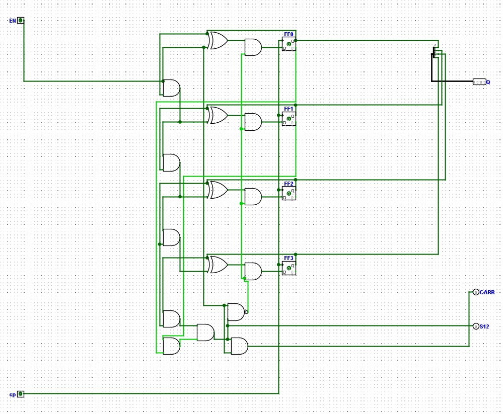

# logisim-mcp

> 把 Logisim-evolution 接进 AI 工作流的 MCP 插件：**查几何 → 声明式生成 → 静态体检 → 网表仿真 → Logisim 真值表复核**，全链路可验证，不用手算一个坐标。

[](https://github.com/CosmoXing/logisim-mcp/actions/workflows/ci.yml)
[](LICENSE)
[](https://www.python.org/)
[](https://github.com/logisim-evolution/logisim-evolution)

---

## 长什么样

**顶层** `main`：时钟进 `CounterDue`，右侧两位十六进制数码管 + 溢出 LED（时钟开着，正在走字）：


**中间层** `CounterDue`：`cp` 同时打到两个 `Counter13`，左边的 `AND` / `NAND` 负责「到 `CC` 就停住、点亮 LED」，
右侧 `OH` / `OL` 是两位输出。


**门级** `Counter13`（一位的内部）：4 个 D 触发器、每位一组异或/与门算次态、右上角分线器把 4 位
并成总线，没有用到任何现成计数器件：



整个工程三层（`main` → `CounterDue` → `Counter13`），26 个门与触发器全部由一份网表生成，**没有一根隧道**。

下面的数字不是手写的，是 `circ_sim` 一拍一拍推出来的原文：

```text
t      OH     OL    LED
0    0000   0000      0      上电
1    0000   0001      0
12   0000   1100      0      低位到 C
13   0001   0000      0      进位，低位归零
…    …      …         …
167  1100   1011      0
168  1100   1100      1      两位都到 C：停住，LED 亮
172  1100   1100      1      再打 4 拍也不动
```

> 为什么不用 Logisim 自带的测试向量验：`-w` 每行都从初始状态重新求值，触发器状态不会在行之间保持，
> 时序电路只能靠 `circ_sim` 逐拍推——上面这张表就是这么来的。

## 它解决什么问题

Logisim-evolution 是纯 Java Swing 桌面程序，没有任何脚本或网络接口。想用代码生成电路，只有两条老路，都不好用：

- **手写 `.circ` 的 XML**：坐标是按元件几何算出来的。门输入口在 5.0 是 `loc.x-50`，3.9 是 `-20`；触发器 `Q(0,0)` 与 `~Q(0,20)` 只隔 20px；子电路端口按 facing 分边而不是等距排。错一个就进入"每修好一处、另一处又坏"的循环。
- **只用 `-t table` 验**：它只告诉你结果是 `E`，不告诉你哪根线断了。而 `-w` 测试向量**每一行都从初始状态重新求值**，根本验不了时序电路。

这个插件补的是中间那一层：一份可信的几何数据源、一个会避让端口的迷宫布线器、一个能跑多拍的网表仿真器，以及一份会成长的踩坑库。

## 特性

| 能力 | 说明 |
|---|---|
| **声明式生成** | 写网表（`pins` / `components` / `nets`），自动布局 + A* 布线；**不使用隧道**，符合多数课程作业限制 |
| **静态体检** | 落盘后重建网表，报悬空 / 多驱动冲突 / 孤立端口 / 元件体重叠，定位到网络名与坐标 |
| **多拍仿真** | 逐拍推进，**逐触发器检测各自的时钟沿**——同步与行波级联都算得对 |
| **几何与交叉复核** | 生成/布线/解析统一按 5.0 源码公式；`selftest` 再用 Logisim 真值表做外部复核 |
| **失败显性** | 遇到不认识的元件（内置计数器、寄存器、复用器）直接报错并列出名字与位置，绝不"忽略元件继续跑" |
| **经验库** | 随包 9 条实测坑（`circ_kb` 可增补；技能里另有 51 条坑表） |
| **零依赖** | 纯 Python 标准库；Java 只在跑 Logisim 原生能力时需要 |

## 安装

### 方式一：作为插件安装（推荐）

插件按 WorkBuddy / CodeBuddy 的插件规范打包（`.codebuddy-plugin/plugin.json` + `.mcp.json` + `skills/`）。

```bash
git clone https://github.com/CosmoXing/logisim-mcp.git
cd logisim-mcp
python tools/install.py            # 注册本地市场 logisim-local
```

然后在插件管理页安装 `logisim-mcp`，并到「自定义连接器」里对 `logisim` 点一次 **信任（Trust）**。

不想注册市场，也可以只写 MCP 配置：

```bash
python tools/install.py --mcp-only       # 直接并入 ~/.workbuddy/mcp.json
python tools/install.py --uninstall      # 撤销
```

### 方式二：手动接任意 MCP 客户端

在客户端的 MCP 配置里加：

```json
{
  "mcpServers": {
    "logisim": {
      "type": "stdio",
      "command": "python",
      "args": ["<插件绝对路径>/server/server.py"],
      "cwd": "<插件绝对路径>",
      "env": { "PYTHONUTF8": "1", "PYTHONIOENCODING": "utf-8" }
    }
  }
}
```

> Windows 上如果 `python` 不在 PATH，把 `command` 换成解释器绝对路径，或用 `bin/run-mcp.cmd`。

### 方式三：完全不用 MCP

`skills/logisim-circuit-design/scripts/` 里的三个脚本可以独立运行：

```bash
python skills/logisim-circuit-design/scripts/verify.py table skills/logisim-circuit-design/assets/full-adder.circ
python skills/logisim-circuit-design/scripts/verify.py stats demo.circ
python skills/logisim-circuit-design/scripts/verify.py vector main case.vec demo_test.circ
```

## 依赖与环境

| 依赖 | 必需 | 说明 |
|---|---|---|
| Python 3.8+ | 是 | 只用标准库，无需 `pip install` |
| Java | 否 | 只有真值表 / 统计 / `-w` / GUI 需要 |
| `logisim-evolution-*-all.jar` | 否 | 同上。生成、体检、网表仿真是纯 Python |

**jar 的查找顺序**：

```
LOGISIM_JAR 环境变量
  → <插件>/logisim.local.json 的 "jar"
  → <插件>/runtime/*.jar
  → ${CODEBUDDY_PLUGIN_DATA}/runtime/
  → Program Files / Program Files (x86) / LOCALAPPDATA 下的 logisim-evolution/app
  → ~/.logisim、~/logisim
  → 当前目录
```

想随插件分发内核，把 jar 放进 `runtime/`；只想本机用，就复制 `logisim.local.example.json` 为 `logisim.local.json` 填路径（已被 gitignore）。

## 自检

```bash
python server/server.py --doctor     # 环境体检：python / java / jar / 知识库 / 清单
python tools/selftest.py             # 29 项端到端回归（含失败路径与 Logisim 交叉复核）
python tools/check_release.py        # 开源发布检查：版本一致 / 无本机痕迹 / 打包内容
```

`--doctor` 输出示例：

```
插件根目录 : .../logisim-mcp
服务端版本 : logisim 1.1.0
Python     : 3.12.4 (/usr/bin/python3)
Java       : /usr/bin/java
内核 jar   : ~/.logisim/logisim-evolution-5.0.0-all.jar
经验库     : .../knowledge.json
  条目数   : 9
  可写     : 是
插件清单   : logisim-mcp 1.1.0（skills=1）
生成/体检  : ok（悬空 0，冲突 0）
网表仿真   : a=1,b=1 → y=1（应为 1）
```

## 工具一览（14 个）

| 工具 | 作用 |
|---|---|
| `logisim_info` | 探测 jar / Java / 无头能力 |
| `circuit_summary` | 解析 `.circ`，列出电路、引脚（名/向/位宽）、元件数 |
| `circuit_truth_table` | Logisim 真值表。`U` 未知、`E` 冲突；输入 >16 拒绝，默认截断 4096 行 |
| `circuit_verify` | 真值表与期望向量逐条比对 |
| `circuit_test_vector` | `-w` 向量引擎。**只能验组合逻辑** |
| `circuit_stats` | 元件统计 |
| `circuit_build` | 旧版生成器（通道布线 + 隧道），保留兼容 |
| `circuit_open_gui` | 打开 GUI |
| **`circ_geometry`** | 查元件真实端口偏移 / 包围盒（5.0 源码 + 实测） |
| **`circ_audit`** | 静态体检：悬空 / 多驱动 / 孤立 / 重叠 |
| **`circ_sim`** | 网表级多拍仿真，逐触发器检测时钟沿 |
| **`circ_build`** | 声明式多电路生成，迷宫布线，不使用隧道 |
| **`circ_kb`** | 经验库：list / search / add |
| **`circ_appearance`** | 在运行中的 Logisim JVM 里编辑子电路外观：get / auto / apply / preview / save / reset / close |

## 60 秒例子

```
circ_build  {"file":"/tmp/demo.circ","circuits":[{"name":"main",
  "pins":[{"label":"a","dir":"in"},{"label":"b","dir":"in"},{"label":"y","dir":"out"}],
  "components":[{"id":"g1","type":"AND"}],
  "nets":[{"name":"a","connect":["pin:a","g1.a"]},
          {"name":"b","connect":["pin:b","g1.b"]},
          {"name":"y","connect":["g1.out","pin:y"]}]}]}

circ_audit  {"file":"/tmp/demo.circ"}                         # → 体检结论: ok
circ_sim    {"file":"/tmp/demo.circ","inputs":{"a":1,"b":1}}  # → y=1
```

生成的文件可以直接用 Logisim 打开、仿真、截图。

## 子电路外观编辑

`circ_appearance` 在 Logisim 自己的 JVM 内调用 `CircuitAppearance`，界面实时刷新：

```bash
python tools/build_bridge.py          # 需要 JDK 21+，生成 runtime/bridge/logisim-bridge.jar
```

```json
{"action":"auto",   "file":"D:/work/2.3.circ", "circuit":"mul"}
{"action":"preview","file":"D:/work/2.3.circ", "circuit":"mul", "out":"D:/work/mul.png"}
{"action":"save",   "file":"D:/work/2.3.circ", "circuit":"mul"}
```

默认保留现有端口坐标（避免父电路导线脱开），只重画框体/名称牌/标签；要均匀重排端口，传
`"layout":{"preserve_port_positions":false}`，返回的 `impact` 会给出受影响的父电路导线数。
详见 [`docs/APPEARANCE.md`](docs/APPEARANCE.md)。

## 架构

```
            ┌──────────────────────────────────────────────┐
 MCP 客户端  │  server.py  (stdio JSON-RPC, 13 tools)       │
            └───────┬───────────────────────────┬──────────┘
                    │                           │
        ┌───────────▼──────────┐    ┌───────────▼───────────┐
        │ circuit_kit          │    │ 外部进程               │
        │  geometry  端口几何   │    │  java -jar … -t table  │
        │  router    A* 布线    │    │  java -jar … -w        │
        │  netlist   解析+仿真  │    └───────────────────────┘
        │  builder   DSL→工程   │
        │  audit     静态体检   │    ← 端口公式与 5.0 源码对齐
        │  knowledge 经验库     │
        └──────────────────────┘
```

关键设计：`geometry.py`（生成侧）、`router.py`（布线）与 `netlist.py`（解析侧）都按 5.0 源码实现端口公式。
三处目前是同源拷贝，改几何常量必须同步；只改一处会让生成、体检、仿真对不上。

## 兼容性

| 项 | 支持 |
|---|---|
| Logisim-evolution | 5.0（默认，几何按 5.0 源码）／ 3.9（读写兼容，但端口坐标不同，见技能里的对照表） |
| Python | 3.8+（CI 覆盖 3.9 与 3.12） |
| 操作系统 | Windows / macOS / Linux（`.cmd` 与 `.sh` 启动器） |
| MCP 协议 | `2024-11-05`（stdio） |

## 已知限制

- **`-w` 不能验时序**：Logisim 每行都重置状态。时序请用 `circ_sim`，或把触发器换成引脚做组合镜像。
- **stdio 单线程**：一次长真值表会挡住后续调用。这是 stdio 的常态，未引入线程池（会带来子进程回收问题）。
- **不做 GUI 自动化**：截图、点按钮仍需人工。`circuit_open_gui` 只负责把文件打开。
- **只覆盖数字电路**：模拟电路、Verilog/VHDL 综合不在范围内。

## 目录结构

```
.
├── .codebuddy-plugin/plugin.json   插件清单（名称/版本/随包技能）
├── .mcp.json                       MCP 服务声明（stdio）
├── bin/                            启动器（自动定位 python）
├── server/
│   ├── server.py                   13 个工具 + --doctor
│   └── circuit_kit/                geometry / router / netlist / builder / audit / knowledge
├── skills/logisim-circuit-design/  随包技能：SKILL.md + 6 份参考 + 3 个脚本 + 示例电路
├── tools/                          selftest / build_zip / install / sync_skill / check_release
├── docs/                           架构说明、插件规范、截图
└── examples/                       可直接打开的示例电路（含两位 13 进制计数器）
```

## 文档

| 文档 | 内容 |
|---|---|
| [`docs/ARCHITECTURE.md`](docs/ARCHITECTURE.md) | 模块职责、数据流、为什么两套几何 |
| [`docs/PLUGIN-SPEC.md`](docs/PLUGIN-SPEC.md) | 插件目录规范、`plugin.json` / `.mcp.json` 字段、占位符 |
| [`docs/DESIGN-NOTES.md`](docs/DESIGN-NOTES.md) | 从 0 到 1 的取舍：为什么不用隧道、为什么失败要显性 |
| `skills/.../references/counter13-casebook.md` | 十三进制计数器复盘：13 个坑 + 排查决策树 |
| `skills/.../references/pitfalls.md` | 51 条实测坑表 |

## 开发

```bash
python tools/selftest.py                # 全量回归
python tools/selftest.py --quick        # 跳过依赖 Java 的用例
python tools/check_release.py --build   # 检查并生成 dist/zip
python tools/sync_skill.py              # 对比插件技能与用户目录
```

代码风格：仅标准库、4 空格缩进、UTF-8、LF；每加一个能力都要能被 `selftest` 覆盖。

## 贡献

见 [CONTRIBUTING.md](CONTRIBUTING.md)。最有价值的贡献是**新的踩坑记录**：
用 `circ_kb add` 记一条，或直接改 `server/circuit_kit/knowledge.json` 提 PR。

## 许可

[MIT](LICENSE)。

---

## English

`logisim-mcp` is an MCP plugin for **Logisim-evolution**: it generates `.circ` files from a declarative netlist
(maze routing, no tunnels), audits connectivity before you open them, simulates them cycle-by-cycle
(per-flip-flop edge detection, so ripple chains work), and cross-checks the result against Logisim's own
truth-table engine. Pure standard-library Python; Java is optional.

Why: `.circ` coordinates are derived from component geometry — gate inputs sit at `loc.x-50` in 5.0 but `-20` in 3.9 —
and Logisim's `-w` test vectors re-evaluate every row from the initial state, so they cannot validate sequential logic.
This plugin fills that gap with one trusted geometry source, a router that treats every port as forbidden,
and a multi-cycle netlist simulator.

```bash
python tools/install.py --mcp-only     # or register the bundled plugin marketplace
python tools/selftest.py               # 29 end-to-end checks
```

MIT licensed.
